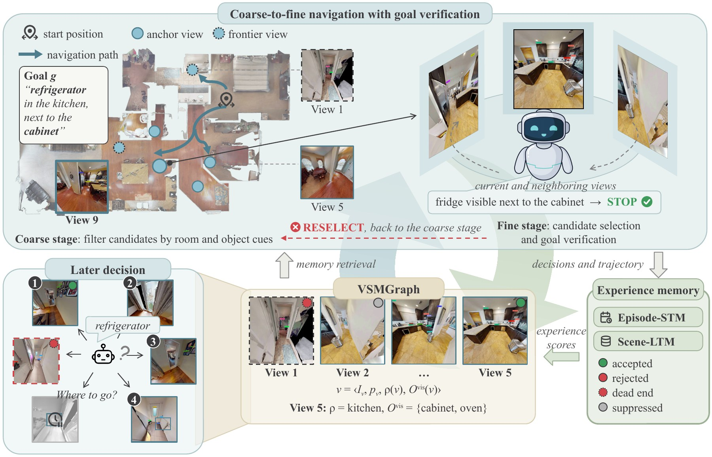
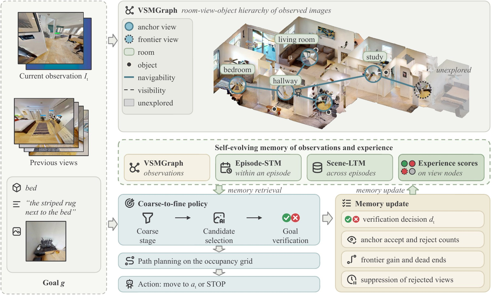
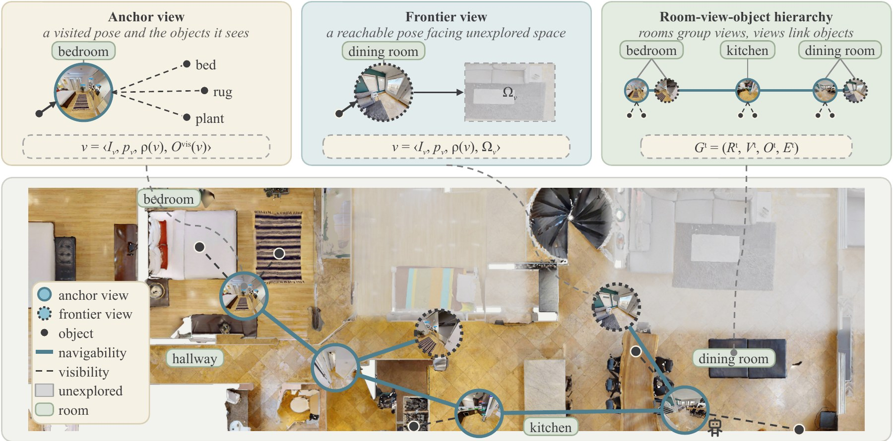
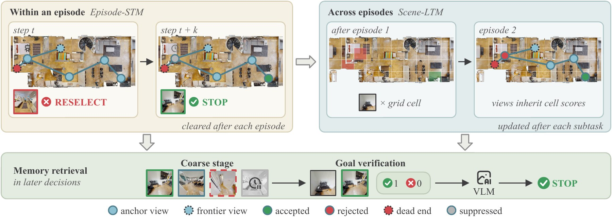
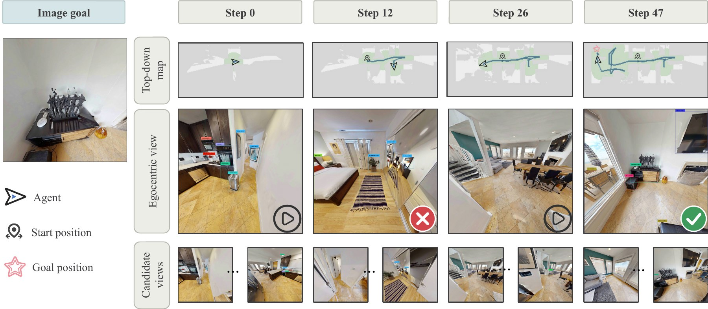
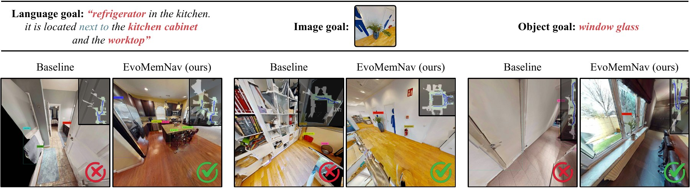

<div align="center">

# EvoMemNav

### Self-Evolving Memory of Observations and Experience for Zero-Shot Embodied Navigation

Zuhao Ge, Xiaosong Jia, Chao Wu, Yuchen Zhou, Zuxuan Wu, Yu-Gang Jiang

Institute of Trustworthy Embodied AI, Fudan University · Shanghai Key Laboratory of Multimodal Embodied AI

[](https://arxiv.org/abs/2606.03509)

</div>

<p align="center"></p>

EvoMemNav is a training-free agent for multi-modal lifelong navigation. Its memory stores what the agent has observed and what it has learned from its own feedback:

- **Visual-Semantic Memory Graph (VSMGraph).** Observed images are kept as view nodes and organized into a room-view-object hierarchy, so that goal verification can use instance-level visual evidence.
- **Budgeted coarse-to-fine policy.** A coarse stage filters at most $K_A$ anchor views and $K_F$ frontier views. A fine stage invokes the VLM only to select one of them and to verify the goal before stopping.
- **Self-evolving experience memory.** Verification decisions (`STOP` / `RESELECT`) and the trajectory history are accumulated as experience scores on the view nodes, in an episodic memory (Episode-STM) and a long-term scene memory (Scene-LTM). These scores rank the candidates and inform goal verification in later decisions.

With the open-source Qwen3-VL, EvoMemNav reaches **59.6 SR / 38.9 SPL** on GOAT-Bench.

This repository contains the GOAT-Bench evaluation of EvoMemNav.

## Method

<p align="center"></p>

<details>
<summary><b>VSMGraph and experience memory</b></summary>

<p align="center"></p>
<p align="center"></p>

</details>

The experience memory is updated only from the agent's own verification decisions and trajectory. The goal viewpoints of the benchmark are read only after a subtask ends, to compute SR and SPL.

## Results

### GOAT-Bench (validation unseen)

| Method | Training-free | SR | SPL |
| --- | :---: | :---: | :---: |
| SenseAct-NN Monolithic | ✗ | 12.3 | 6.8 |
| Modular CLIP on Wheels | ✓ | 16.1 | 10.4 |
| Modular GOAT | ✓ | 24.9 | 17.2 |
| SenseAct-NN Skill Chain | ✗ | 29.5 | 11.3 |
| VLMnav | ✓ | 20.1 | 9.6 |
| DyNaVLM | ✓ | 25.5 | 10.2 |
| TANGO | ✓ | 32.1 | 16.5 |
| 3D-Mem† | ✓ | 42.6 | 22.8 |
| MTU3D | ✗ | 47.2 | 27.7 |
| MSGNav | ✓ | <u>52.0</u> | <u>29.6</u> |
| **EvoMemNav (ours)** | ✓ | **59.6** | **38.9** |

† reproduced with the same VLM as ours.

<details>
<summary><b>HM3D object-goal navigation</b></summary>

| Method | Training-free | HM3Dv1 SR | HM3Dv1 SPL | HM3Dv2 SR | HM3Dv2 SPL |
| --- | :---: | :---: | :---: | :---: | :---: |
| ZSON | ✗ | 25.5 | 12.6 | – | – |
| PixNav | ✗ | 37.9 | 20.5 | – | – |
| SPNet | ✗ | 31.2 | 10.1 | – | – |
| VLFM | ✗ | 52.5 | 30.4 | <u>63.6</u> | <u>32.5</u> |
| SGM | ✗ | <u>60.2</u> | 30.8 | – | – |
| ESC | ✓ | 39.2 | 22.3 | – | – |
| L3MVN | ✓ | 50.4 | 23.1 | 36.3 | 15.7 |
| VoroNav | ✓ | 42.0 | 26.0 | – | – |
| OpenFMNav | ✓ | 54.9 | 24.4 | – | – |
| InstructNav | ✓ | – | – | 58.0 | 20.9 |
| VLFM* | ✓ | 50.9 | 23.6 | 56.9 | 27.5 |
| GAMap | ✓ | 53.1 | 26.0 | – | – |
| SG-Nav | ✓ | 54.0 | 24.9 | 49.6 | 25.5 |
| UniGoal | ✓ | 54.5 | 25.1 | – | – |
| TriHelper | ✓ | 56.5 | 25.3 | – | – |
| WMNav | ✓ | 58.1 | <u>31.2</u> | – | – |
| MFNP | ✓ | 58.3 | 26.7 | – | – |
| BeliefMapNav | ✓ | **61.4** | 30.6 | – | – |
| **EvoMemNav (ours)** | ✓ | 59.2 | **33.6** | **63.8** | **39.4** |

HM3Dv2 results of VLFM, L3MVN, SG-Nav and VLFM* are taken from ApexNav; VLFM* replaces the trained PointNav policy of VLFM with a shortest-path planner.

</details>

### Contribution of each component

GOAT-Bench validation unseen:

| Variant | SR | SPL |
| --- | :---: | :---: |
| VSMGraph | 43.7 | 27.9 |
| + Coarse-to-fine policy | 55.4 | 36.1 |
| + Experience memory (EvoMemNav) | **59.6** | **38.9** |

### Qualitative results

<p align="center"></p>

At step 12 the agent reaches an anchor view and takes a picture in a mirror for the target statue. Goal verification returns `RESELECT`, the view is suppressed, and the agent stops at step 47 after verifying the correct instance.

<details>
<summary><b>Comparison with the baseline</b></summary>
<p align="center"></p>
</details>

## Data

```
data/
├── hm3d_v0.2/{train,val}/<scene>/        # HM3D v0.2 scenes (.basis.glb, .basis.navmesh)
├── goat_bench/val_unseen/content/*.json  # GOAT-Bench validation unseen episodes
├── hm3d_annotated_basis.scene_dataset_config.json   (included)
└── scannet200_classes.txt                            (included, detector vocabulary)
```

- HM3D v0.2: follow the [HM3D instructions](https://github.com/matterport/habitat-matterport-3dresearch).
- GOAT-Bench episodes: follow the [GOAT-Bench instructions](https://github.com/Ram81/goat-bench).

## VLM server

EvoMemNav queries Qwen3-VL through an OpenAI-compatible API, for example with vLLM:

```bash
vllm serve Qwen/Qwen3-VL-8B-Instruct --served-model-name Qwen3-VL-8B-Instruct \
    --port 8000 --max-model-len 8192 --limit-mm-per-prompt '{"image": 48}'
```

The endpoint and model name are set in the `vlm` block of the config. The API key is read from the environment variable named by `vlm.api_key_env` (default `OPENAI_API_KEY`).

## Evaluation

```bash
# GOAT-Bench validation unseen
python run_goatbench.py --cfg cfg/evomemnav_goatbench.yaml

# split the scenes over several GPUs
CUDA_VISIBLE_DEVICES=0 python run_goatbench.py --cfg cfg/evomemnav_goatbench.yaml --start_ratio 0.0 --end_ratio 0.5 &
CUDA_VISIBLE_DEVICES=1 python run_goatbench.py --cfg cfg/evomemnav_goatbench.yaml --start_ratio 0.5 --end_ratio 1.0 &
```

Each run writes `results/<exp_name>/subtasks_*.jsonl` (one record per subtask), `summary.json` (SR and SPL overall and per goal modality, and the cost per subtask), the logs, and Scene-LTM under `scene_ltm/<scene_id>.json`. Scene-LTM starts empty for a new output directory and accumulates over the episodes of each scene, which run in order. An interrupted run resumes from the first unfinished episode.

## Code structure

```
run_goatbench.py              evaluation entry point
cfg/                          EvoMemNav config and ConceptGraphs settings
evomemnav/
├── agent.py                  one episode / subtask of EvoMemNav
├── config.py                 config loading and command-line overrides
├── env/                      Habitat scene, object instances, GOAT-Bench goals and metrics
├── mapping/                  TSDF, occupancy grid, frontier views, path planning
├── memory/                   VSMGraph, view records, co-visibility clustering
├── policy/                   coarse stage, candidate selection, goal verification
├── experience/               goal and node keys, Episode-STM, Scene-LTM
├── vlm/                      OpenAI-compatible client and the three prompts
├── eval/                     subtask records and summaries
└── third_party/conceptgraph/ object mapping utilities from ConceptGraphs
```

## Citation

```bibtex
@article{ge2026evomemnav,
  title   = {EvoMemNav: Efficient Self-Evolving Fine-Grained Memory for Zero-Shot Embodied Navigation},
  author  = {Ge, Zuhao and Jia, Xiaosong and Wu, Chao and Zhou, Yuchen and Wu, Zuxuan and Jiang, Yu-Gang},
  journal = {arXiv preprint arXiv:2606.03509},
  year    = {2026}
}
```

## Acknowledgements

This codebase is built upon [3D-Mem](https://github.com/UMass-Embodied-AGI/3D-Mem). We also use code from [ConceptGraphs](https://github.com/concept-graphs/concept-graphs), [HiPart](https://github.com/panagiotisanagnostou/HiPart) and [tsdf-fusion-python](https://github.com/andyzeng/tsdf-fusion-python), and models from [YOLO-World](https://github.com/AILab-CVC/YOLO-World), [SAM](https://github.com/facebookresearch/segment-anything), [OpenCLIP](https://github.com/mlfoundations/open_clip) and [Qwen3-VL](https://github.com/QwenLM/Qwen3-VL). The benchmark runs in [Habitat](https://github.com/facebookresearch/habitat-sim) on [GOAT-Bench](https://github.com/Ram81/goat-bench).

## License

MIT License. See [LICENSE](LICENSE). Files adapted from other projects keep their original license headers.
